# Air Quality Sensor

A DIY open-source air quality monitor built around an [ESP32-C3-WROOM-02](https://documentation.espressif.com/esp32-c3-wroom-02_datasheet_en.pdf), featuring a custom 4-layer PCB with four Sensirion/Bosch sensors, a laser-cut glass top panel, and a 3D-printed holder. Firmware runs on [ESPHome](https://esphome.io) and integrates natively with Home Assistant. An optional [PMSA003I particulate matter add-on](#particle-sensor-add-on) connects via the onboard QWIIC connector to add PM1.0, PM2.5, PM10, and EPA AQI measurements.

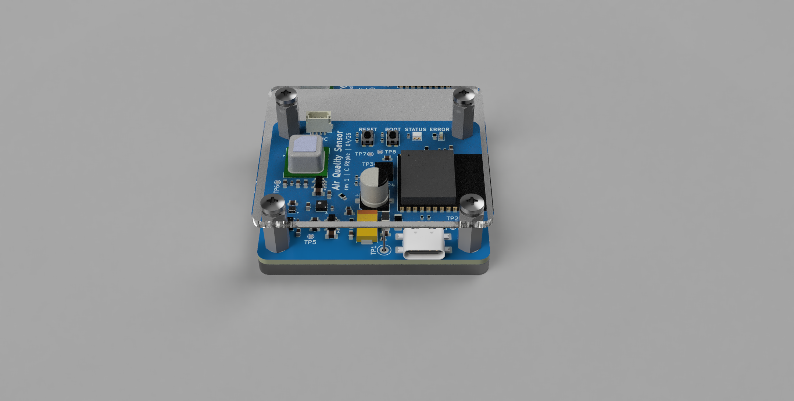

---

## Table of contents

- [What it measures](#what-it-measures)
- [System overview](#system-overview)
- [Hardware design](#hardware-design)
  - [Sensors](#sensors)
  - [Power system](#power-system)
  - [PCB](#pcb)
  - [Enclosure](#enclosure)
- [Assembly](#assembly)
  - [Soldering](#soldering)
  - [I2C addresses](#i2c-addresses)
  - [Power-on checklist](#power-on-checklist)
- [Firmware](#firmware)
  - [Getting started](#getting-started)
  - [LED behavior](#led-behavior)
  - [Home Assistant entities](#home-assistant-entities)
  - [Web interface](#web-interface)
  - [Diagnostic configs](#diagnostic-configs)
- [Particle sensor add-on](#particle-sensor-add-on)
  - [Hardware](#hardware)
  - [Firmware (PM variant)](#firmware-pm-variant)
  - [Additional Home Assistant entities](#additional-home-assistant-entities)
- [Manufacturing](#manufacturing)
- [License](#license)

---

## What it measures

| Sensor | Measurements | Notes | Datasheet |
|--------|-------------|-------|-----------|
| **Sensirion SCD41** | CO₂ (ppm), temperature, humidity | Primary air quality signal | [PDF](https://sensirion.com/media/documents/48C4B7FB/67FE0194/CD_DS_SCD4x_Datasheet_D1.pdf) |
| **Sensirion SGP41** | VOC Index (1–500), NOx Index (1–500) | Always active; LED falls back to VOC if CO₂ unavailable | [PDF](https://sensirion.com/media/documents/5FE8673C/61E96F50/Sensirion_Gas_Sensors_Datasheet_SGP41.pdf) |
| **Sensirion SHT40** | Temperature (±0.2 °C), humidity (±1.8 %RH) | Reference for sensor compensation | [PDF](https://sensirion.com/resource/datasheet/sht4x) |
| **Bosch BMP280** | Barometric pressure, temperature | CO₂ altitude compensation source | [PDF](https://www.bosch-sensortec.com/media/boschsensortec/downloads/datasheets/bst-bmp280-ds001.pdf) |
| **Plantower PMSA003I** *(optional add-on)* | PM1.0, PM2.5, PM10 (µg/m³), particle counts | Via QWIIC connector; requires PM firmware variant | [PDF](docs/particle_sensor_addon/4505_PMSA003I_series_data_manual_English_V2.6.pdf) |

---

## System overview

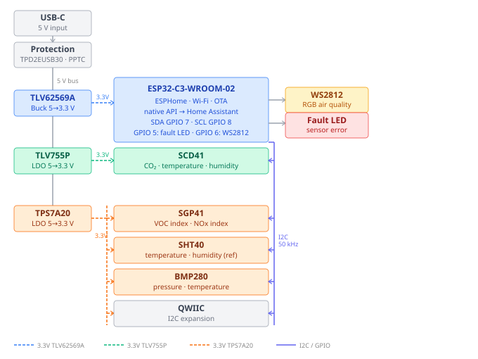

The ESP32-C3 sits at the center of the design. All four sensors share a single I2C bus running at 50 kHz. The BMP280 pressure reading feeds the SCD41's ambient pressure compensation input. The firmware consolidates the three redundant temperature sensors and two humidity sensors into single median-based values, which in turn feed the SGP41's gas compensation algorithm. This cross-sensor compensation is why all four sensors are present even though some measurements overlap.

---

## Hardware design

### Sensors

**SCD41 — CO₂**

The SCD41 uses photoacoustic NDIR (non-dispersive infrared) technology to measure CO₂ directly. CO₂ is the primary metric for indoor air quality: levels above 1000 ppm are linked to reduced concentration, and above 2000 ppm cause noticeable cognitive effects. The SCD41 includes automatic self-calibration (ASC), which compensates for long-term sensor drift by assuming the sensor sees outdoor-quality air (≈400 ppm) for at least one hour per day. It also accepts an ambient pressure input from the BMP280 to correct for altitude-induced measurement error.

**SGP41 — VOC and NOx**

The SGP41 uses a metal oxide (MOX) sensing element to detect volatile organic compounds and nitrogen oxides. Rather than reporting raw concentrations, it outputs a processed index (1–500) where 100 represents a typical indoor baseline. This makes it well-suited for detecting events like cooking, cleaning products, paint fumes, or combustion without requiring gas-specific calibration. It also serves as the fallback air quality signal when CO₂ data is unavailable — the LED logic prefers CO₂ but degrades gracefully to VOC index.

**SHT40 — Temperature and humidity (reference)**

The SHT40 is the most accurate temperature and humidity sensor on the board, and it carries double weight in the firmware's median-based sensor fusion. The consolidated Temperature and Humidity entities shown in Home Assistant draw on all available sensors but are dominated by the SHT40 when it agrees with the others. The SCD41 and BMP280 also have internal temperature sensors, but they run warmer due to self-heating and contribute as secondary inputs.

All sensors on this board are affected by self-heating from the SGP41's MOX element (which runs an internal heater at ~400 °C), the ESP32-C3 Wi-Fi radio, and the power regulators. The firmware applies empirically calibrated offset corrections: −5.5 °C / +8 %RH for the SHT40, −5.5 °C for the BMP280, and −1.5 °C / +4 %RH for the SCD41. These values may need tuning — place a known-good reference thermometer next to the board, let everything stabilize for 30+ minutes, and adjust the offsets in the YAML until they match.

**BMP280 — Barometric pressure**

The BMP280 adds barometric pressure, which has two uses: it feeds the SCD41's ambient pressure compensation input (NDIR CO₂ sensors read differently at different altitudes), and it provides weather-correlation data for the Home Assistant dashboard.

**PMSA003I — Particulate matter (optional add-on)**

The Plantower PMSA003I is a laser scattering particle sensor that measures PM1.0, PM2.5, and PM10 mass concentrations as well as particle counts across six size bins (0.3–10 µm). It connects via the onboard QWIIC connector and is powered from the ESP32's 3.3 V buck rail. The firmware calculates a US EPA AQI from the PM2.5 reading and classifies the likely particle source from the PM2.5/PM10 ratio. See the [Particle sensor add-on](#particle-sensor-add-on) section for setup details.

---

### Power system

The board takes 5 V via USB-C. Any standard USB-C power supply rated ≥1 A works — no USB Power Delivery negotiation is required, and charge-only cables (no data lines) are fine.

The power path is:

**USB-C → TPD2EUSB30 (ESD protection) → PPTC fuse (750 mA self-resetting) → three separate 3.3 V rails**

Three regulators run in parallel off the 5 V bus, each feeding a dedicated load:

- **[TLV62569A](https://www.ti.com/lit/ds/symlink/tlv62569a.pdf)** (synchronous buck converter) → ESP32-C3 and QWIIC connector. The buck is efficient for the ESP32's variable current draw. The QWIIC connector shares this rail, keeping the sensitive sensor LDO rails free from expansion board loads.
- **[TLV755P](https://www.ti.com/lit/ds/symlink/tlv755p.pdf)** (LDO) → SCD41. The SCD41's photoacoustic CO₂ measurement is sensitive to supply noise; a dedicated LDO with a higher current rating than the TPS7A20 keeps its rail clean and isolated.
- **[TPS7A20](https://www.ti.com/lit/ds/symlink/tps7a20.pdf)** (ultra-low-noise LDO, 10 µVRMS) → SGP41, SHT40, and BMP280. The SGP41's MOX element and SHT40's capacitive humidity sensor are especially susceptible to supply noise; the TPS7A20 keeps all three on a single clean rail, isolated from both the buck and the SCD41's LDO.

The **PPTC fuse** is a self-resetting polyfuse rated at 750 mA, protecting the board against overcurrent faults without requiring manual intervention.

---

### PCB

<table>
  <tr>
    <td>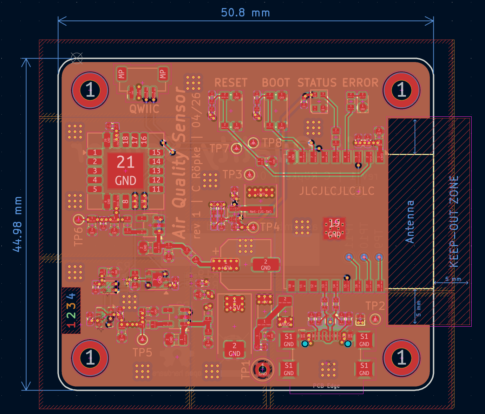</td>
    <td>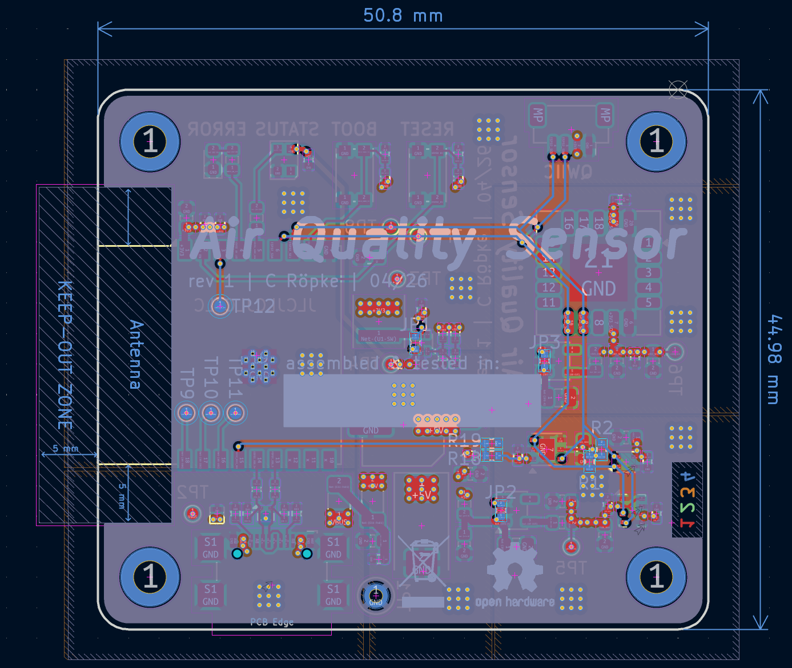</td>
  </tr>
  <tr>
    <td align="center"><em>Top copper layer</em></td>
    <td align="center"><em>Bottom copper layer</em></td>
  </tr>
</table>

<table>
  <tr>
    <td>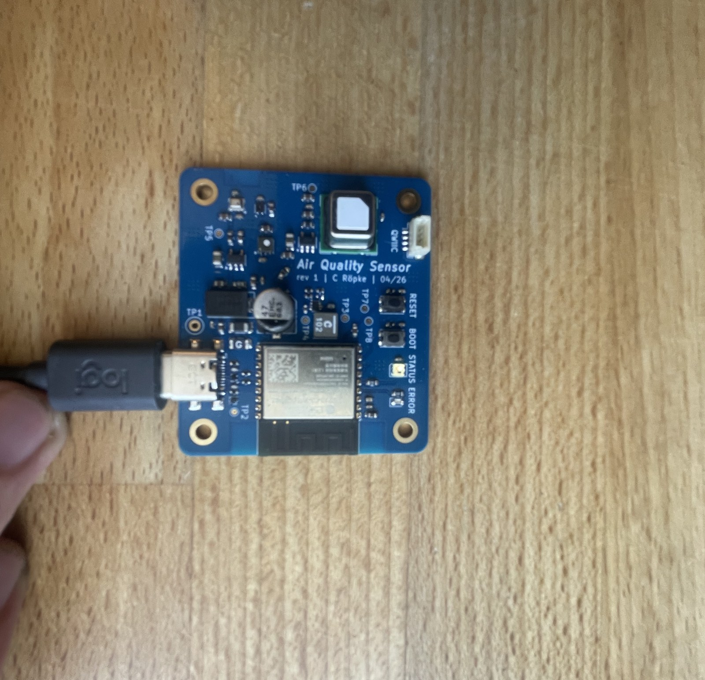</td>
    <td>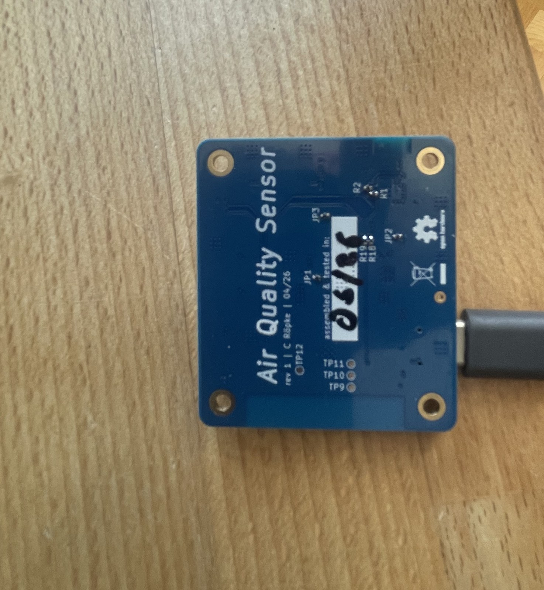</td>
  </tr>
  <tr>
    <td align="center"><em>Component side — ESP32, SCD41, regulators</em></td>
    <td align="center"><em>Bottom side — silkscreen</em></td>
  </tr>
</table>

The PCB is a 4-layer board designed in [KiCad](https://www.kicad.org/). Bare boards were manufactured by [JLCPCB](https://jlcpcb.com/) and assembled by hand.

Layer stackup: signal / GND plane / power plane / signal. The dedicated ground and power planes provide clean returns and reduce radiated noise — important given the sensitive gas sensors on the same board.

The board uses a mix of 0402 and 0603 passives, with all ICs in small SMD packages. The custom footprint for the SGP41 (`air_quality_footprints.pretty/`) is included in the repository because it is not in the standard KiCad library.

---

### Enclosure

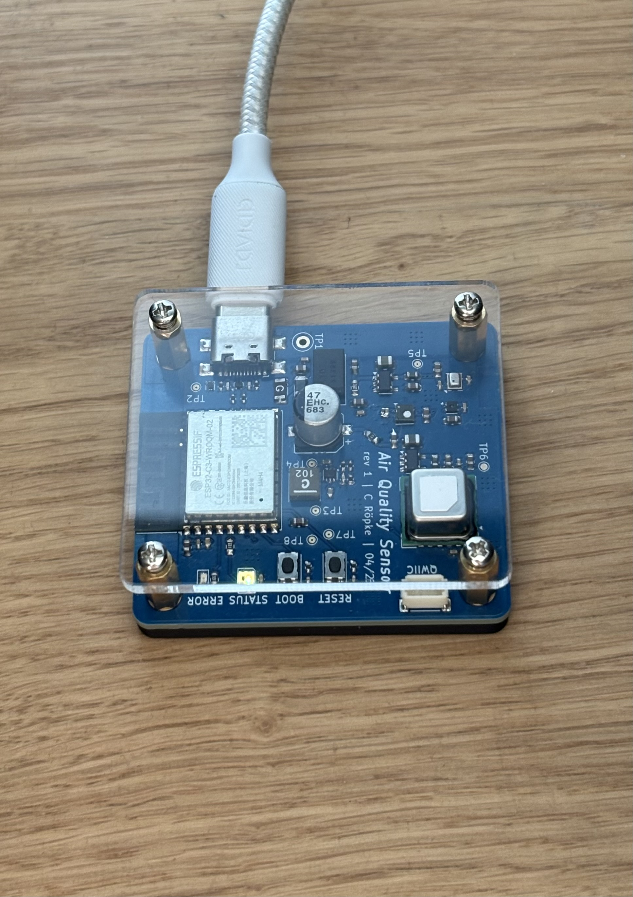
*Sensor on a shelf in the bedroom (base variant, no PM add-on).*

The enclosure consists of three parts:

**3D-printed holder** (`hardware/enclosure/air_quality_sensor_holder.f3d`, `.stl`): holds the PCB and provides ventilation for the sensors. Print in PLA or PETG at 0.2 mm layer height. The PM variant uses a modified holder (`hardware/enclosure/particle_sensor_addon/air_quality_sensor_particle_sensor_addon_holder.f3d`, `.stl`) with a mount for the Adafruit PMSA003I breakout. It requires 2 additional M2 heat-set inserts (same type as used for the glass top) and 2 additional M2 screws (same as used for the glass top).

**Laser-cut glass top** (`hardware/enclosure/air_quality_sensor_glass_top.dxf`, `.step`, `.f3d`): 2 mm clear glass, sourced from [Formulor](https://www.formulor.de) using the provided DXF file.

**Standoffs**: [M2.5 × 10 mm male-female hex standoffs](https://www.amazon.de/dp/B0C1FY87PY) (5 mm across flats) mount between the PCB and the glass top. The Fusion 360 model is included at `hardware/enclosure/Standoff mf - M2.5 x 10 across flats 5mm.f3d`.

**Heated inserts**: [M2.5 heat-set inserts](https://www.amazon.de/dp/B0F2TGGBMC) are pressed into the 3D-printed holder with a soldering iron before screwing in the standoffs. This gives the plastic threads much better durability than screwing directly into printed material.

**Power supply and cable**: 5 V/1 A USB-A wall charger + USB-C to USB-A cable. Any charger rated ≥1 A works. Tested with: [RAVIAD USB-C Kabel 1 m (€3.99)](https://www.amazon.de/gp/product/B0GT379MW7) and [18W USB-A Ladegerät, 4er-Pack (€19.98)](https://www.amazon.de/gp/product/B0CRS1YX4S).

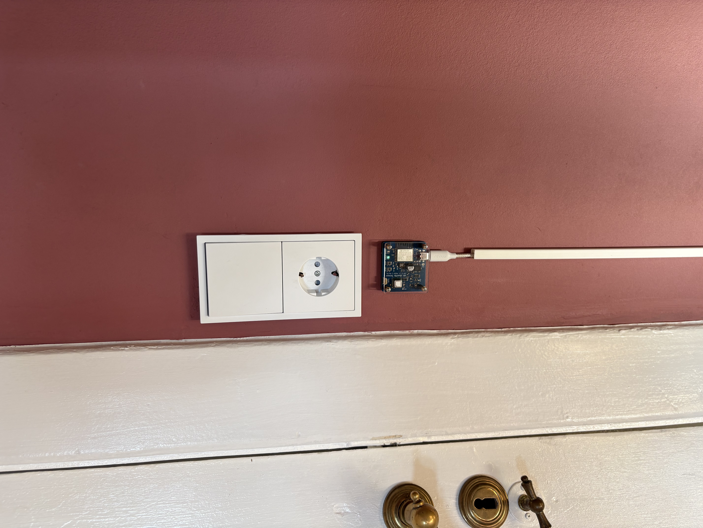
*Sensor installed in the living room (base variant, no PM add-on) — wall-mounted.*


---

## Assembly

### Soldering

All components are SMD. The board was assembled using solder paste and a hotplate for the initial reflow, followed by hand rework with a soldering iron for touch-ups.

Recommended soldering order — ICs and sensor packages before passives, connectors last:

1. **ESP32-C3-WROOM-02** — the largest IC; solder the pads around the perimeter, then reflow the exposed pad underneath with a hot-air station or by heating the board from below.
2. **TLV62569A, TLV755P, TPS7A20, TPD2EUSB30** — small SOT/WSON packages; drag-solder or use solder paste + hot air.
3. **SGP41** — custom footprint (`air_quality_footprints.pretty/`); ensure the exposed pad underneath is soldered for both mechanical and thermal contact.
4. **SCD41, SHT40, BMP280** — Sensirion LCC packages; reflow carefully, avoid excess heat on the SCD41 optical aperture.
5. **0402/0603 passives** — resistors and capacitors.
6. **USB-C connector, WS2812, LEDs, standoff holes** — connectors and through-board components last.

Use the interactive BOM (`hardware/pcb/air_quality_sensor/bom/ibom.html`) during assembly — it highlights each component on the board overlay and is the easiest way to avoid placing components in the wrong location. Open it locally in any browser, no server required.

The schematic PDF (`hardware/pcb/air_quality_sensor/air_quality_sensor-schematic.pdf`) is the reference for component values and net names.

### I2C addresses

| Sensor | I2C address | Configurable? |
|--------|-------------|---------------|
| SCD41 | 0x62 | No |
| SGP41 | 0x59 | No |
| SHT40 | 0x44 | No |
| BMP280 | 0x76 | Via SDIO pin (0x76 or 0x77) |
| PMSA003I *(PM add-on, optional)* | 0x12 | No |

The firmware enables I2C bus scanning on boot (`scan: true`). With a serial monitor connected, boot log output will list all detected addresses — a quick way to confirm all four sensors are soldered correctly and communicating before flashing the full config.

### Power-on checklist

Before flashing for the first time:

1. **Visual inspection** — check for solder bridges on the ESP32 and sensor pads under magnification.
2. **Continuity check** — verify no short between the three 3.3V rails, and no short between any rail and GND.
3. **Apply 5V via USB-C** — measure voltage on each 3.3V rail with a multimeter before the ESP32 is powered. Expected: ~3.3V on all three rails.
4. **Check quiescent current** — with sensors powered but ESP32 not yet flashed, current draw should be low (a few mA). A high reading suggests a solder bridge or incorrect component.
5. **Flash firmware** — once voltage rails check out, proceed to the firmware getting started section.
6. **Verify I2C scan** — open the serial monitor and confirm all four sensor addresses appear in the boot log.

---

## Firmware

The firmware is a single [ESPHome](https://esphome.io) YAML configuration. ESPHome compiles it to a native binary for the ESP32-C3 and handles OTA updates, the web server, and the Home Assistant native API automatically.

### Getting started

**Prerequisites:** ESPHome installed (`pip install esphome` or via the Home Assistant add-on).

1. Copy `firmware/secrets.yaml.example` to `firmware/secrets.yaml` and fill in all four values:

   ```yaml
   wifi_ssid: "your-network"
   wifi_password: "your-password"
   api_encryption_key: "your-base64-encryption-key"
   ota_password: "your-ota-password"
   ```

   The `api_encryption_key` is a 32-byte random key used to encrypt the connection between ESPHome and Home Assistant. Generate one with:

   ```bash
   openssl rand -base64 32
   ```

   Alternatively, run `esphome wizard firmware/air-quality-sensor.yaml` and ESPHome will generate and fill in all secrets interactively.

   The `ota_password` can be any string — you'll be prompted for it when pushing firmware updates over the air.

2. Flash via USB using the included wrapper script:

   ```bash
   cd firmware
   ./flash.sh Wohnzimmer                        # first flash: interactive port selection
   ./flash.sh Kueche --device 192.168.178.132   # target a known IP for OTA
   ```

   The `location` argument (e.g. `Wohnzimmer`, `Kueche`) is stamped into the device's friendly name in Home Assistant, so multiple boards are distinguishable. The script also derives the firmware version from git — the current tag if HEAD is tagged, otherwise `dev-YYYY-MM-DD`, with `-dirty` appended if there are uncommitted changes, and `-pm` appended for the PM variant (e.g. `v1.1.0-pm`, `v1.1.0-dirty-pm`). This makes the active variant immediately visible in Home Assistant.

   For manual invocation without the wrapper:

   ```bash
   esphome -s location "Wohnzimmer" -s firmware_version "dev-manual" run air-quality-sensor.yaml
   ```

3. **Deployed boards: updates via GitHub releases.** Each installed board has a config `firmware/device-<room>.yaml` that pins its location and variant (`./flash.sh kueche` uses it). After the first flash, a GitHub release is built by a small update server on the LAN, and Home Assistant shows it as a normal *Update available* for each board. Setup, release flow and rollback: [docs/ota-server.md](docs/ota-server.md).

3. All subsequent updates are over-the-air automatically.

**Multiple boards:** the firmware is designed to be shared across boards unchanged. `name_add_mac_suffix: true` appends the last 3 bytes of each board's WiFi MAC to its hostname (e.g. `air-quality-sensor-a1b2c3.local`), so boards don't conflict on the network. Only the `location` substitution at flash time differs.

**Home Assistant:** once on the network the device is auto-discovered via the native API. Go to Settings → Integrations and accept the discovered device. All entities appear immediately.

---

### LED behavior

The WS2812 RGB LED on the board gives an at-a-glance air quality reading. The firmware prefers CO₂ from the SCD41 as the primary signal; if that sensor is unavailable, it falls back to the VOC index from the SGP41.

| Color | CO₂ (preferred) | VOC Index (fallback) |
|-------|-----------------|----------------------|
| 🟢 Green | < 800 ppm | < 150 |
| 🟡 Yellow | 800–1200 ppm | 150–250 |
| 🔴 Red | > 1200 ppm | > 250 |

All three thresholds (green→yellow, yellow→red, and a separate pulse threshold) are exposed as configurable Number entities in Home Assistant — no reflash needed to tune them. The defaults above apply on first boot.

Above the pulse threshold (default 1500 ppm CO₂ / 350 VOC), the LED switches from solid to a slow pulse (30–80% brightness, 1 s cycle) to draw attention to critically poor air quality.

Brightness defaults to 25% on first boot and is then fully user-controlled from Home Assistant. The chosen brightness persists across reboots. The LED can also be turned on/off from HA — the on/off state persists independently of brightness. Color updates are intentionally instant (no transition fade) so the reading snaps to the new value as soon as a sensor reports.

The LED driver is activated 5 seconds after boot to avoid a crash in the WS2812 driver before its internal buffer is initialized. During this window the LED stays off regardless of sensor data.

A second red LED (the fault LED) lights up whenever any sensor stops reporting valid data. It re-evaluates every 30 seconds as a backstop against sensors going silently missing.

---

### Home Assistant entities

The device exposes a rich set of entities organized into three tiers in the HA device page:

**Primary (visible on the main card)**

| Entity | Description |
|--------|-------------|
| Temperature | Consolidated from SHT40, BMP280, SCD41 via median + outlier rejection (SHT40 weighted 2×) |
| Humidity | Consolidated from SHT40 and SCD41; SHT40 preferred if they disagree by > 10 %RH |
| CO₂ | Raw SCD41 reading with ambient pressure compensation from BMP280 |
| VOC Index | SGP41 MOX index (1–500, baseline 100), compensated with consolidated T/H |
| NOx Index | SGP41 NOx index (1–500) |
| Pressure | BMP280 barometric pressure |
| Absolute Humidity | Computed from consolidated T/H via Magnus–Tetens formula (g/m³) |
| Dew Point | Computed from consolidated T/H via Magnus formula (°C) |
| Air Quality Score | Weighted composite: CO₂ 40%, VOC 25%, NOx 15%, temperature comfort 10%, humidity comfort 10% (0–100%) |
| Comfort Zone | ASHRAE-inspired classification: Comfortable / Acceptable / Too cold / Too hot / Too dry / Too humid |
| Air Quality LED | RGB light entity — color and pulse controlled by firmware, brightness/on-off by user |
| Sensor Fault | Binary problem sensor — on if any sensor stops publishing |
| Particle Sensor Addon Found | Binary connectivity sensor — true if the PMSA003I responds on the I2C bus (probed on boot and every 30s). Present in both variants; also turns true in the base variant if the sensor is plugged in, indicating the PM firmware should be flashed. |

**Controls**

| Entity | Description |
|--------|-------------|
| Boost Mode | Switch — reduces all sensor update intervals from 30 s to 5 s for fast feedback (e.g. while cooking) |
| Threshold CO₂ Green→Yellow | Configurable ppm threshold (default 800) |
| Threshold CO₂ Yellow→Red | Configurable ppm threshold (default 1200) |
| Threshold CO₂ Pulse (Critical) | Triggers pulse effect above this level (default 1500 ppm) |
| Threshold VOC Green→Yellow | Configurable VOC index (default 150) |
| Threshold VOC Yellow→Red | Configurable VOC index (default 250) |
| Threshold VOC Pulse (Critical) | Triggers pulse effect above this level (default 350) |

**Diagnostics** (collapsed by default in HA)

Per-sensor raw values (Temperature SHT40/BMP280/SCD41, Humidity SHT40/SCD41), per-sensor health (0/100%), peak CO₂/VOC/NOx/temperature/humidity since boot, time spent in each air quality category today (minutes), 5V rail voltage, uptime, reboot count, firmware version, temperature/humidity source attribution with drift annotation, last crash reason.

---

### Web interface

The device runs a built-in web server on port 80. Because `name_add_mac_suffix` is enabled, the hostname includes the board's MAC suffix — navigate to `http://air-quality-sensor-XXXXXX.local` (the exact hostname is printed in the ESPHome boot log) or use the device's IP address directly. Any browser on the same network works.

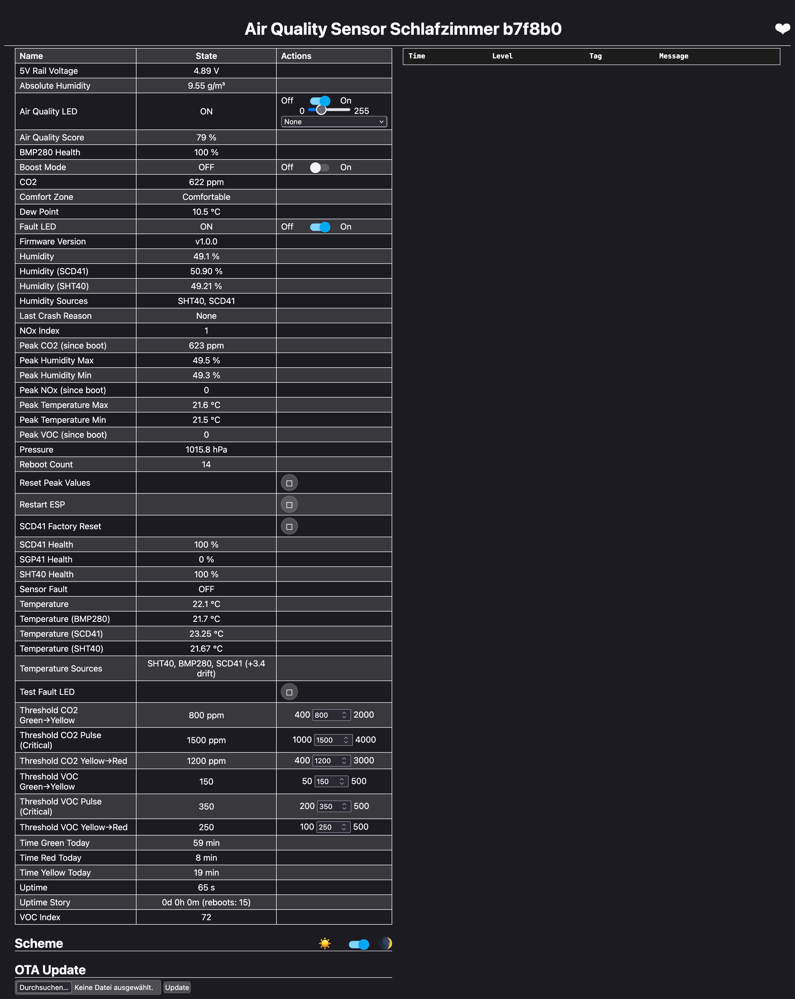
*Base variant — the PM add-on entities are not shown.*

Diagnostic buttons available in the web UI and in Home Assistant:

| Button | Effect |
|--------|--------|
| **Test Fault LED** | Turns the fault LED on for 2 seconds — useful for confirming the LED is soldered and working. |
| **SCD41 Factory Reset** | Clears the SCD41's calibration history and restarts the ESP32. Use if CO₂ readings look wrong after long transport or storage. |
| **Reset Peak Values** | Resets all peak observations (CO₂, VOC, NOx, temperature, humidity) back to their initial sentinels, so the next reading establishes a new peak. |
| **Restart ESP** | Reboots the ESP32. |

If the device cannot reach your Wi-Fi network it falls back to an access point: SSID `Air-Quality Fallback`, password `configureme`. Connect to it and navigate to `http://192.168.4.1` to reconfigure.

---

### Diagnostic configs

Two additional ESPHome configs are included for debugging the SCD41:

| File | Purpose |
|------|---------|
| `diagnostic-scd41-only.yaml` | Runs only the SCD41 in isolation — useful for ruling out I2C address conflicts |
| `diagnostic-scd41-deep.yaml` | Extended SCD41 diagnostics with verbose sensor logging |

Flash a diagnostic config the same way as the main config:

```bash
esphome run firmware/diagnostic-scd41-only.yaml
```

---

## Particle sensor add-on

The QWIIC connector on the board exposes the I2C bus, allowing an [Adafruit PMSA003I Air Quality Breakout](https://www.adafruit.com/product/4632) to be connected without any soldering. This add-on extends the sensor with PM1.0, PM2.5, and PM10 mass concentration measurements, EPA AQI calculation, and particle source classification.

The PM variant is a separate firmware build that includes the base firmware plus an additional package. Both variants expose a **Particle Sensor Addon Found** binary sensor — it reflects whether the PMSA003I responds on the I2C bus, so even the base firmware turns it true if the sensor is plugged in, making it clear that the PM variant should be flashed.

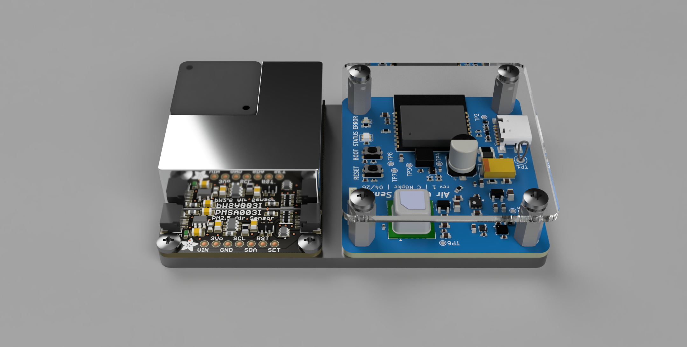

### Hardware

Connect the Adafruit PMSA003I breakout to the board's QWIIC connector with a QWIIC cable — a 50 mm cable fits cleanly. No other wiring is needed; the breakout is powered and communicates entirely over the 4-pin QWIIC connector (3.3 V, GND, SDA, SCL). The PMSA003I appears at I2C address **0x12**.

The PMSA003I sensor module has mounting holes intended to screw it down to the breakout PCB, but Adafruit doesn't include screws — the module is only held by its connector pads, which isn't particularly solid. Double-sided tape between the module and the breakout PCB fixes this. The two remaining mounting holes on the breakout are used to screw the whole assembly to the holder.

**LED mod (recommended)**

The Adafruit PMSA003I breakout has a status LED that competes visually with the air quality LED on the main board — the air quality LED should be the primary indicator. The breakout's status LED resistor (R1) was changed from 10 kΩ to 100 kΩ to dim it significantly. Alternatively, the LED can be desoldered entirely.

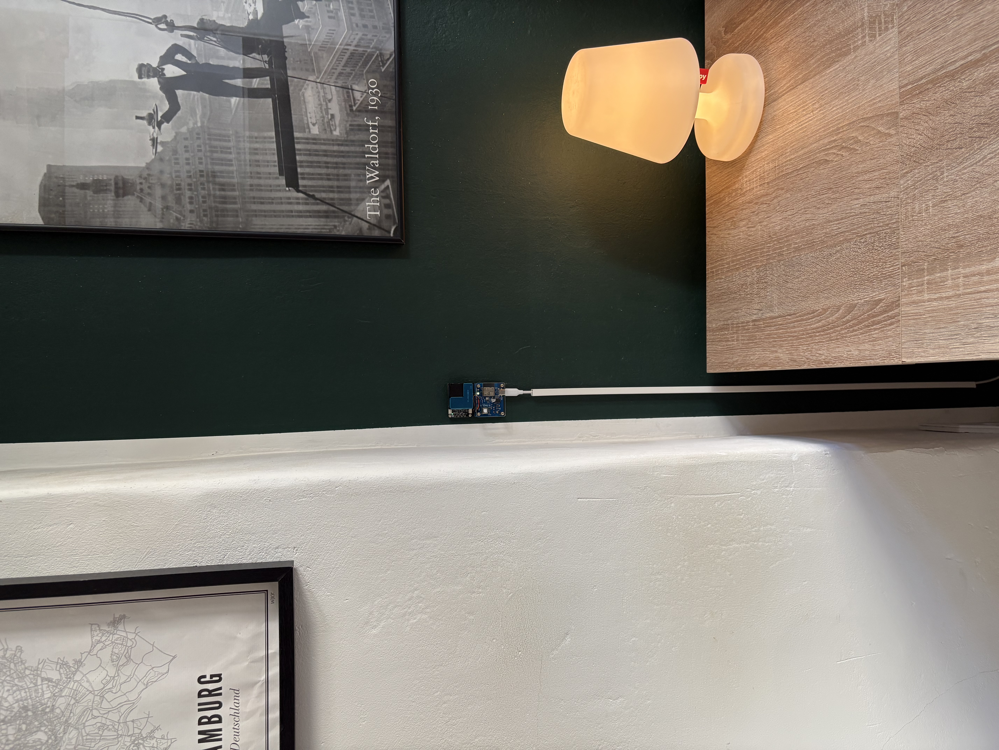
*Sensor wall-mounted in the kitchen with PMSA003I PM add-on.*

### Firmware (PM variant)

Flash the PM variant using the `--pm` flag:

```bash
cd firmware
./flash.sh Schlafzimmer --pm                           # first flash: interactive port selection
./flash.sh Schlafzimmer --pm --device 192.168.178.132  # OTA to a known IP
```

When switching between the base and PM variant, the flash script automatically cleans the build cache to avoid PlatformIO errors from stale component objects.

To revert to the base firmware without the PM package:

```bash
./flash.sh Schlafzimmer --device 192.168.178.132
```

### Additional Home Assistant entities

All entities below are added when flashing the PM variant. In the PM variant the PMSA003I is a required sensor: if it is missing from the I2C bus or stops reporting data, the fault LED lights up — same behaviour as the onboard sensors.

**Primary**

| Entity | Description |
|--------|-------------|
| PM 1.0 | Mass concentration of particles ≤ 1 µm (µg/m³) |
| PM 2.5 | Mass concentration of particles ≤ 2.5 µm (µg/m³) |
| PM 10.0 | Mass concentration of particles ≤ 10 µm (µg/m³) |
| EPA AQI (PM2.5) | US EPA Air Quality Index calculated from PM2.5 (0–500) |
| EPA AQI Category | Human-readable label: Good / Moderate / Unhealthy for Sensitive Groups / Unhealthy / Very Unhealthy / Hazardous |
| Air Quality Score (Extended) | Composite score (0–100%) with PM2.5 added at 15% weight; other weights rebalanced: CO₂ 35%, VOC 20%, NOx 15%, temperature/humidity comfort 7.5% each |
| Particle Source | Classification from PM2.5/PM10 ratio: Combustion (cooking / candles / traffic) / Mixed / Coarse (dust / pollen / abrasion) |

**Diagnostics**

| Entity | Description |
|--------|-------------|
| PMC >0.3 µm | Particle count per 0.1 L of air for particles > 0.3 µm |
| PMC >0.5 µm | Particle count per 0.1 L of air for particles > 0.5 µm |
| PMC >1.0 µm | Particle count per 0.1 L of air for particles > 1.0 µm |
| PMC >2.5 µm | Particle count per 0.1 L of air for particles > 2.5 µm |
| PMC >5.0 µm | Particle count per 0.1 L of air for particles > 5.0 µm |
| PMC >10.0 µm | Particle count per 0.1 L of air for particles > 10.0 µm |

---

## Manufacturing

PCB production files are in `hardware/pcb/air_quality_sensor/jlcpcb/`:

| File | Purpose |
|------|---------|
| `gerber/GERBER-air_quality_sensor.zip` | Upload to JLCPCB (or any fab) to order the bare PCB |
| `production_files/BOM-air_quality_sensor.csv` | Bill of materials — use for sourcing components |
| `production_files/CPL-air_quality_sensor.csv` | Component placement file — reference for hand assembly positioning |

Order the bare PCB from JLCPCB using the Gerber zip. Source components separately (Mouser, LCSC, DigiKey) using the BOM, then assemble by hand — see the [Assembly](#assembly) section above for the recommended process.

The schematic PDF (`hardware/pcb/air_quality_sensor/air_quality_sensor-schematic.pdf`) and interactive BOM (`hardware/pcb/air_quality_sensor/bom/ibom.html`) are the primary references during assembly.

---

## License

Hardware (PCB schematics, layout, enclosure files) is licensed under the [CERN Open Hardware Licence Version 2 – Strongly Reciprocal (CERN-OHL-S-2.0)](https://ohwr.org/cern_ohl_s_v2.txt).

Firmware is licensed under the [MIT License](https://opensource.org/licenses/MIT).

In short: you can use, modify, and manufacture this design freely — including commercially — as long as any modifications to the hardware are released under the same licence.
